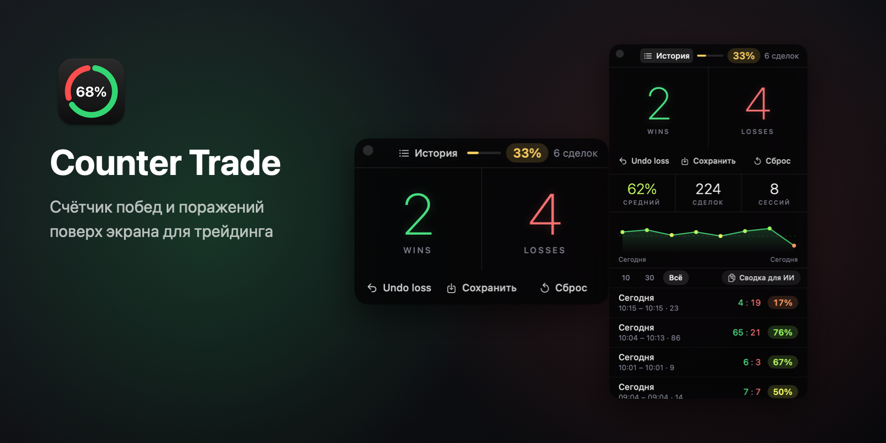
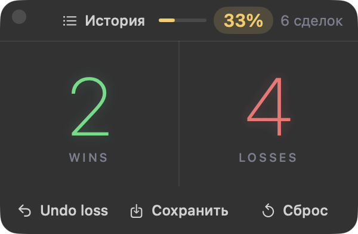
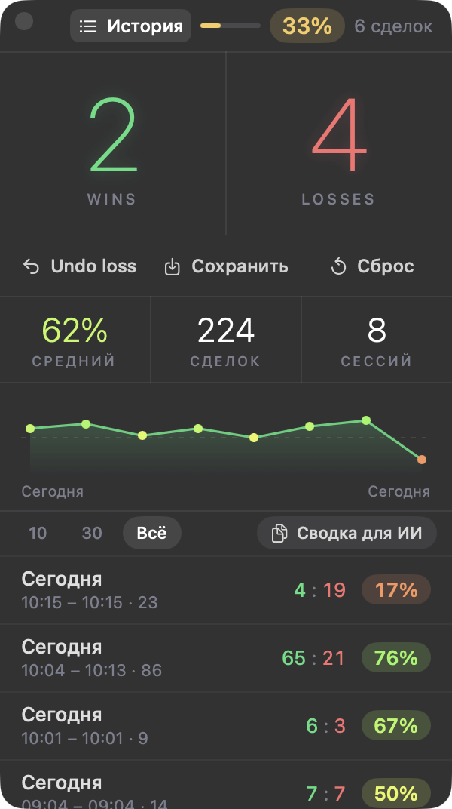

<p align="center"></p>

<h1 align="center">Counter Trade</h1>

<p align="center">Узкий счётчик побед и поражений для трейдинга.<br>Окно лежит поверх всех программ и почти не мешает: смотришь на график, жмёшь ← или →, видишь винрейт.</p>

<p align="center"><a href="../../releases/latest"><b>Скачать для macOS</b></a> · macOS 14 или новее</p>

---

## Что умеет

<table>
<tr>
<td width="50%" valign="top">

<p><b>Счётчик</b><br>Победы слева, поражения справа, сверху винрейт и полоска. Клик по половине или клавиши ← и → добавляют сделку.</p>
</td>
<td width="50%" valign="top">

<p><b>История</b><br>Итоги, график винрейта по сессиям и список. Наведи на точку графика, кликни, чтобы найти сессию в списке.</p>
</td>
</tr>
</table>

- **←** победа, **→** поражение, **⌫** отмена последней сделки. Клавиши работают, когда окно в фокусе; мышью можно кликать по зелёной и красной половинам.
- **Сохранить** кладёт текущую сессию в историю и обнуляет счёт.
- **Сброс** сразу обнуляет счёт без сохранения и без вопросов.
- **История** выдвигается под счётчиком. Правый клик по сессии удаляет её.
- **Сводка для ИИ** копирует весь журнал текстом. Вставь его в чат с ИИ и спроси, что не так.
- Три победы подряд — конфетти.
- Через полторы секунды без мыши окно становится полупрозрачным, числа остаются яркими.
- **⌃⌥W** показывает и прячет окно из любого приложения.
- Красная кнопка окна только прячет его. Вернуть: иконка в Dock, значок в строке меню или ⌃⌥W. Выйти: **⌘Q**, меню или правый клик по иконке в Dock.

## Установка

1. Скачай **Counter-Trade.dmg** на странице [Releases](../../releases/latest).
2. Открой его и перетащи **Counter Trade** в папку **Программы**.
3. Первый запуск: приложение не подписано сертификатом Apple, поэтому macOS предупредит. Нажми правой кнопкой по Counter Trade → **Открыть** → **Открыть**. Если и так не пускает, выполни в Терминале:
   ```bash
   xattr -dr com.apple.quarantine "/Applications/Counter Trade.app"
   ```

## Где хранятся данные

`~/Library/Application Support/Counter Trade/`

- `sessions.jsonl` — архив, по сессии на строку. Дописывается, сам ничего не стирает.
- `current.json` — текущая сессия.

Раньше приложение называлось Winrate и хранило данные в папке `Winrate`. При первом запуске они копируются оттуда сами, старая папка остаётся.

Чтобы начать с нуля, закрой приложение и удали папку `Counter Trade`.

## Сборка из исходников

Нужны только Command Line Tools.

```bash
./build.sh          # build/Counter Trade.app
./build.sh run      # собрать и запустить
./build.sh install  # положить в ~/Applications
./build.sh dmg      # build/Counter-Trade.dmg
```

Иконку и обложку для README можно перерисовать: `./tools/make-icon.sh`, `swift tools/make-hero.swift`.
